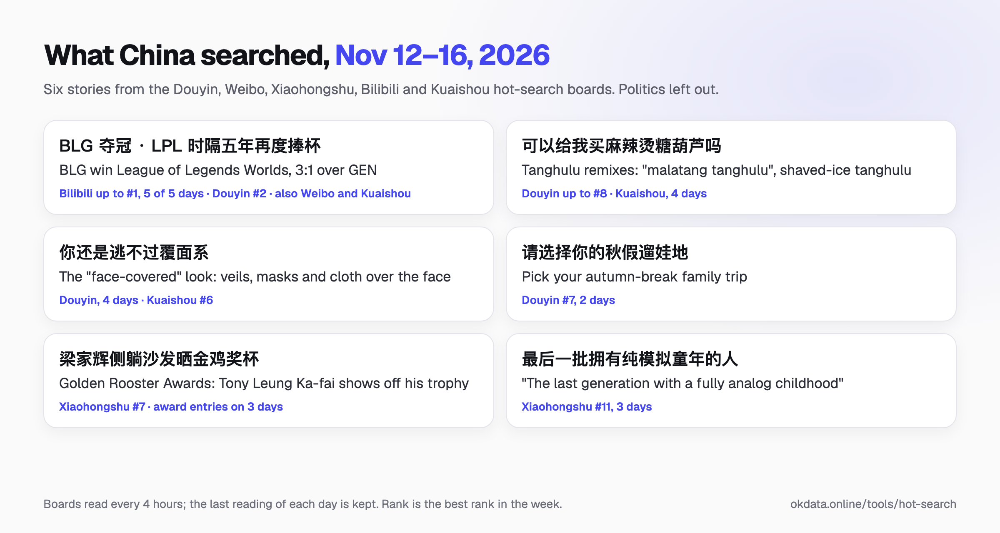

# What China searched this week: Douyin, Weibo and Xiaohongshu trends in English (Nov 12–16, 2026)

Chinese social apps publish their trending searches all day, and almost none of it reaches English. This is a week of it, translated, from the Douyin, Weibo, Xiaohongshu, Bilibili and Kuaishou boards. Politics, deaths and unverified news about named people are left out; what is left is what people were talking about.



## 1. BLG won League of Legends Worlds, and every board knew

Bilibili Gaming beat Gen.G 3:1 in the final of the League of Legends World Championship. Search terms celebrating it called it the LPL's first world title in five years. It ran on four of the five boards:

- **Bilibili:** up to No. 1, on the board all five days, with entries such as 弹幕合影和新华社一起恭喜BLG ("a bullet-comment group photo, congratulating BLG together with Xinhua").
- **Douyin:** up to No. 2, with entries such as BLG一穿四LCK战队 ("BLG beat four LCK teams in a row").
- **Kuaishou:** up to No. 11, with entries such as 快手老铁花式庆祝BLG夺冠 (Kuaishou users celebrating the win).
- **Weibo:** a lower spot, mostly about the people around it: sponsors (BLG夺冠赞助商赢麻了, "BLG's sponsors are winning big") and a singer dedicating a song to the team.

If you sponsor or sell to young men in China, this week's attention was here.

## 2. Tanghulu, remixed

Tanghulu, candied hawthorn on a stick, is a winter street snack, and this winter it is being crossed with everything:

- **可以给我买麻辣烫糖葫芦吗** ("Can you buy me a malatang tanghulu?"): tanghulu made to look like a skewer of spicy hotpot. Tanghulu entries reached No. 8 on Douyin, and celebrities joined in.
- **东北冰糖葫芦咬开全是冰沙** ("Northeastern tanghulu, full of shaved ice when you bite in"): on Kuaishou, where tanghulu entries stayed on the board for four days.
- **手把手教你自制苹果糖** ("Step by step: homemade candy apples"): Xiaohongshu No. 9 for three days, the do-it-yourself version of the same craving.
- **手工敲虾到底有多好吃** ("Just how good is hand-pounded shrimp?"): Douyin No. 3, a regional dish of shrimp pounded thin and cooked.

## 3. The "face-covered" look

**覆面系** (fùmiàn xì) is the look of a face covered by a veil, a mask or cloth, and it spent four days on Douyin: 你还是逃不过覆面系 ("You still can't escape the face-covered look") and a 覆面系转场挑战 transition challenge. On Kuaishou it reached No. 6 on Nov 16. It is a styling and video trend, which makes it easy for brands in beauty, fashion and accessories to borrow.

## 4. Family time: the autumn break

**请选择你的秋假遛娃地** ("Pick where you will take the kids this autumn break") was No. 7 on Douyin for two days. 秋假 is an autumn school holiday that some parts of China have started giving pupils, and it is creating a new short travel season for families. **换季乱穿也能搭** ("Mix anything you like for the change of season") was on the board the same days.

## 5. On screen: the Golden Rooster Awards and an AI gala

- The 39th Golden Rooster Awards, mainland China's main film prizes, filled Xiaohongshu for three days. Entries reached No. 4 (王传君邓家佳金鸡奖同框, two actors photographed together at the ceremony), and 梁家辉侧躺沙发晒金鸡奖杯 (Tony Leung Ka-fai, lying on a sofa, showing off his Best Actor trophy) reached No. 7.
- On Douyin, **首个AI漫剧晚会阵容官宣** ("Line-up announced for the first gala of AI-made animated dramas") stayed on the board two days, a sign of how fast AI-made short series are growing there.
- **爱乐之城群像齐舞挑战**: a group dance challenge to La La Land.

## 6. The small things that travel

- **最后一批拥有纯模拟童年的人** ("The last generation with a fully analog childhood"): Xiaohongshu No. 11 for three days, nostalgia from people born before smartphones.
- **小浣熊太胖挤不进排水口** ("A raccoon too chubby to fit into a drain"): Xiaohongshu No. 5.
- **UP主手搓非遗竹编盛笼** (a creator hand-weaving a traditional bamboo basket): Bilibili No. 3, part of a steady run of craft videos.

## How this list was made

The boards are read every four hours and the last reading of each day is kept, from Nov 12 to Nov 16, 2026. Entries are grouped by topic and ranked by how many days they stayed on and their best rank in the week. Heat numbers are not comparable across apps, so they are not used here. Translations were drafted with a language model, and each Chinese term is kept next to its English so you can search it yourself.

Disclosure: this repository is published by okdata, whose archive the lists come from. The boards are free to read, in English, at https://okdata.online/tools/hot-search/?src=gh-china-trends (Douyin, Weibo, Xiaohongshu, Bilibili, Kuaishou, Reddit and X trends by country). To pull the same lists into a spreadsheet or an AI agent, each board is one API call:

```bash
curl "https://api.okdata.online/v1/douyin/trends/list" \
  -H "Authorization: Bearer $OKDATA_API_KEY"
```

A new key comes with $0.10 of credit: https://okdata.online/signup/?src=gh-china-trends

The raw lists for these five days are in [`data/`](../data/), one CSV per board per day.
